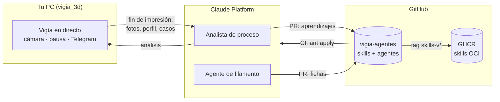

# Vigía 3D · Agentes y skills

Agentes y skills del [Vigía 3D](https://github.com/rexcacayo/vigia_3d) para **Claude Platform**,
gestionados **como código**: cada agente, entorno y skill es un fichero de este repo; los
cambios entran por Pull Request y la CI los publica con `ant apply` (flujo tipo Terraform:
plan en el PR, apply al fusionar, `claude-lock.json` versionado).

Las skills se publican además como **artefactos OCI** en GHCR siguiendo la propuesta de la
comunidad [Agent Skills as OCI Artifacts](https://github.com/ThomasVitale/agents-skills-oci-artifacts-spec),
para poder instalarlas por versión y digest en cualquier proyecto.

## Qué hay

| Ruta | Tipo | Para qué |
|---|---|---|
| `agents/analista-proceso.md` | Agente (Opus) | Tras cada impresión: fotos + perfil laminado + casos → veredicto del proceso, tabla de cambios de perfil y PR con lo aprendido |
| `agents/agente-filamento.md` | Agente (Sonnet) | Consolida el historial de las fichas de filamento en «perfil validado», por PR |
| `environments/vigia-cloud.yaml` | Entorno | Sandbox en la nube con Pillow/NumPy/OpenCV y red limitada |
| `skills/vigia-3d/` | Skill | Criterio de diagnóstico, materiales, correcciones, aprendizajes y fichas de filamento |
| `skills/ad5m-slicer-engineer/` | Skill | Perfiles de OrcaSlicer para la AD5M Pro (modo A) y análisis foto + perfil (modo B) |
| `skills/impresoras-3d/` | Skill | Qué se puede leer y tocar en cada impresora por API; **abierta a nuevos modelos** |

## Cómo encaja con el vigía



- La vigilancia en directo (cámara, pausa, avisos) sigue en el PC: necesita la red local
  de la impresora y reaccionar en segundos.
- El análisis profundo y el mantenimiento del conocimiento viven en la plataforma.
- **El aprendizaje entra siempre por PR**: los agentes proponen, tú apruebas.
- **Una sola fuente de verdad**: el vigía instala estas skills desde GHCR por digest al
  arrancar y al empezar cada impresión (`skills.json` en `vigia_3d`). Lo que aprende entre
  publicaciones va a una capa local que el analista sube aquí por PR; al publicarse, la
  capa local lo reconoce y deja de duplicarlo.

```
👎 / informe ──► capa local del vigía ──► analista (PR) ──► fusionas ──► CI publica OCI
      ▲                                                                       │
      └─────────────── el vigía instala la nueva versión por digest ◄─────────┘
```

## Puesta en marcha (una vez)

1. **Secret de la CI**: en GitHub → Settings → Secrets → Actions, crea `ANTHROPIC_API_KEY`
   (clave del workspace del vigía). Nunca en el repo ni en el chat.
2. **Primer despliegue**: fusiona a `main` (o lanza *Desplegar en Claude Platform* a mano).
   La CI crea skills, entorno y agentes y guarda `claude-lock.json`.
3. **Vault con el token de GitHub** para que los agentes abran PRs (token de grano fino,
   solo este repo, permisos *Contents* y *Pull requests* en lectura/escritura):
   ```bash
   export GITHUB_TOKEN_AGENTES=...      # en tu terminal, no en ficheros
   python scripts/crear_vault.py        # imprime vlt_...
   ```
   Pon ese `vlt_...` y el mismo token en el `.env` del vigía (`VAULT_AGENTES`,
   `GITHUB_TOKEN_AGENTES`).

## Trabajo diario

| Quiero… | Hago |
|---|---|
| Cambiar el criterio de un agente | Edito `agents/*.md` → PR (la CI muestra el plan) → fusiono |
| Mejorar una skill | Edito `skills/<skill>/` → PR → fusiono (nueva versión en la plataforma) |
| Publicar las skills como OCI | Automático al fusionar cambios en `skills/` (versión `0.1.N` + `latest`); para una versión con nombre, `git tag skills-v1.0.0 && git push --tags` |
| Revisar lo que aprendió el analista | PRs `aprendizaje/*` y `fichas/*` |
| Añadir una impresora nueva | Adaptador en `vigia_3d` + sección en `skills/impresoras-3d/SKILL.md` |

Validar en local, sin credenciales: `python scripts/validar.py`.

## Licencia
GPL-3.0, como el vigía.
